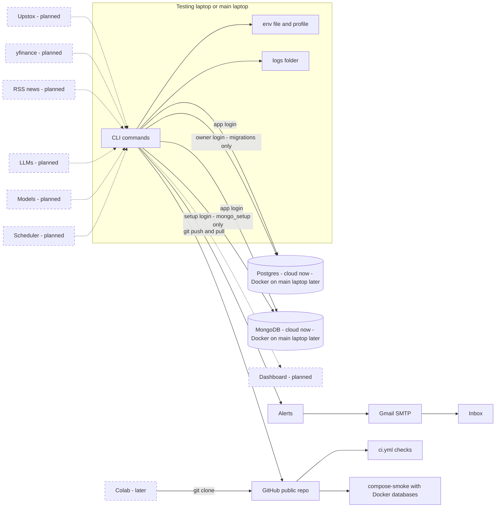
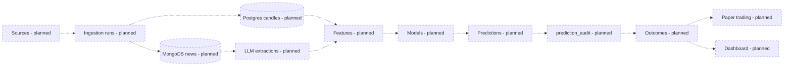

# Architecture

How market-intel works today, and what is planned. For day-to-day operation see the
[runbook](runbook.md); for why things are the way they are, see the [decision log](decisions.md).

## Overview

A command-line project in Python 3.12, run on one of two laptops (synced through git), with a
Postgres database and a MongoDB database. Today both databases are free cloud services; on the
main laptop they will run in Docker. Nothing is scheduled yet: every command runs only when started.

### Components now

Solid lines exist today. Dashed boxes and lines are **planned**.

### Planned data flow

Nothing in this diagram exists yet; it is the plan for Phases 1 to 8.

### Commands

| Command | What it does |
|---|---|
| `python -m market_intel.config` | Prints the settings; secrets show only "set" or "not set" |
| `python -m market_intel.health` | The daily health check (see [Health check](#health-check)) |
| `python -m market_intel.db_check` | Connection, TLS, storage and write test for both databases |
| `python -m market_intel.compute_check` | CPU, RAM, disk and NVIDIA GPU of this machine |
| `python -m market_intel.alerts --test` | Sends one test alert email (`--dry-run` builds it only) |
| `alembic upgrade head` | Applies Postgres migrations (owner login) |
| `python -m market_intel.mongo_setup` | Creates or updates MongoDB collections (setup login) |

All are run with `uv run` in front.

## Laptops and profiles

Each laptop's `.env` sets `APP_PROFILE`, named by what that machine may do:

| Profile | Used on | Databases | Broker keys | One-word hosts (Docker service names) |
|---|---|---|---|---|
| `restricted` | The testing laptop (now): testing and validation | Cloud only (it can't run Docker) | Not allowed (rule R1) | Not local: need TLS |
| `full` | The main laptop (from about 21 Nov 2026): main work | Docker allowed | Allowed | Local |
| `server` | Later hosting | Docker allowed | Allowed | Local |

- The two laptops are used **alternately**, synced through git (see the
  [runbook](runbook.md#daily-routine)).
- The main laptop's Docker setup is task 0.9.
- **Go live** only after validation.

## Configuration and profiles

Settings come from environment variables and one `.env` file per machine (never committed);
see `src/market_intel/config.py`.

- **Loading order:** real environment variables, then `.env` (found at the repo root, or the
  file named by `MARKET_INTEL_ENV_FILE`, e.g. in Docker), then the defaults in code.
- **Empty values mean "use the default"** (`KEY=` counts as not set), so a fresh copy of
  `.env.example` loads cleanly. `.env` only sets what differs.
- **Profiles** (`APP_PROFILE`): `restricted`, `full` or `server` (see
  [Laptops and profiles](#laptops-and-profiles)). The profile decides rule R1 and whether
  one-word hostnames count as local (see the TLS rule below). Any other value is refused with
  an error listing the allowed ones.
- **Groups:** settings are grouped (`database`, `database_admin`, `mongo_admin`, `upstox`,
  `llm`, `alerts`). A group is checked only when code that needs it calls
  `settings.require("<group>")`, which raises a clear error naming the missing variables. So
  the project starts with only `APP_PROFILE` set.
- **Secrets** are `SecretStr` values: they never appear in repr, dumps or error messages.
- **Rules checked at startup:**
  - **R1:** the `restricted` profile refuses to start if Upstox keys are set.
  - **R2:** `LLM_MONTHLY_CAP_INR` defaults to 1000. Above 1000 needs
    `LLM_CAP_RAISE_APPROVED=true`, after an approval logged in the decision log; above 2000 is
    always rejected.
  - **R3:** `LLM_WARN_PCT` must be between 1 and 99 (default 80).
- `DISPLAY_TIMEZONE` (default `Asia/Kolkata`) is used only when showing times; times are
  stored in UTC.

## Where data lives

| What | Where | In git? |
|---|---|---|
| Code, docs, tests | Public GitHub repo (source-available, see [LICENSE](../LICENSE.md)) | Yes |
| `.env` (secrets and machine settings) | Each laptop, copied by hand | **Never** |
| `docker/compose.env` (Docker database passwords) | The main laptop | **Never** |
| `logs/` | JSON log files on each laptop (`LOG_DIR`) | Never |
| `data/` | Local data and state, e.g. `data/state/alert_throttle.json` (`DATA_DIR`) | Never |
| `drive_sync/` | Local folder for exports and backups | Never |
| Postgres tables | The Postgres database (see [Postgres schema v1](#postgres-schema-v1)) | No |
| MongoDB collections | The MongoDB database (see [MongoDB](#mongodb)) | No |

**Never in git:** market data, predictions, signals, model files, paper-trading results and
notebook outputs. `.gitignore` blocks the folders (`data/`, `models/`, `mlruns/`, `logs/`,
`outputs/`, `predictions/`, `signals/`, `reports/`, `backtests/`, `paper_trades/`) and data file
types (`.csv`, `.parquet`, `.feather`, `.h5`, `.db`, `.sqlite`, `.duckdb`, `.xlsx`, `.pkl`,
`.pt`, `.joblib`); only small synthetic files in `tests/fixtures/` are allowed.

## Security model

The repo is public, so this section stays general: no hosts, network rules or user names.

### Two logins per database

| Database | Login | Used by | Rights |
|---|---|---|---|
| Postgres | Owner (`POSTGRES_ADMIN_URL`) | Migrations only | Owns the tables |
| Postgres | `mi_app` (`POSTGRES_URL`) | Everything else | SELECT, INSERT, UPDATE, DELETE on tables; USAGE on sequences; read-only `alembic_version`; TEMP. No CREATE, DROP, ALTER, TRUNCATE |
| MongoDB | Setup (`MONGODB_ADMIN_URI`) | `mongo_setup` only (and cleaning up demo audits) | readWrite + dbAdmin on the database |
| MongoDB | App, role `mi_app_rw` (`MONGODB_URI`) | Everything else | Per named collection, see below |

Rights of the MongoDB role `mi_app_rw`:

| Collection | find | insert | update | remove |
|---|---|---|---|---|
| `news_items`, `llm_extractions` | yes | yes | yes | yes |
| `_healthcheck` | yes | yes | no | yes |
| `prediction_audit` | yes | yes | yes | **no** |

Plus listIndexes and collStats on these four, and database-wide listCollections, dbStats and
killAnyCursor. The app login can't create or drop collections or change indexes and
validators. Rights are per collection because MongoDB's insert right also creates a missing
collection; a database-wide insert would let a typo create a collection with no validator.

### TLS refusal

Every connection (the app, `db_check`, `health`, migrations and `mongo_setup`) goes through
`postgres.connect_url()` or `mongo.client_url()`. These refuse, **before sending anything**, to
reach a database that isn't local unless the connection string forces TLS:

- Postgres: `sslmode=require`, `verify-ca` or `verify-full`.
- MongoDB: `mongodb+srv://`, or `mongodb://` with `tls=true`.

**Local** means `localhost`, `127.0.0.1` or `::1` on every profile. A one-word hostname (a
Docker service name) counts as local only on the `full` and `server` profiles; on `restricted` it
could be any machine on the network, so it needs TLS.

### Secrets, masking and scanning

- Secrets live only in `.env` and `docker/compose.env`, both git-ignored; `.env.example` and
  `docker/compose.env.example` hold names with empty values (a test checks this).
- Logs and alert output mask: values of fields whose names look secret (`key`, `secret`,
  `password`, `token`, `uri`, `url`, ...), passwords inside connection URLs, and every secret
  value loaded from `.env`. Database error messages are also redacted; only hosts are shown.
  Alert recipients appear as `m***@domain`.
- Every commit runs detect-secrets (pre-commit). GitHub secret scanning and push protection
  are on. Safety tests fail if `.env` files, data folders, data file types, files over 1 MB or
  notebooks with outputs are tracked.

### Public repo and SEBI rules

- The repo holds **code and documentation only**: no market data, predictions, signals, model
  files, notebook outputs or paper-trading results.
- The dashboard will run only on the owner's laptop with no other users; predicted-vs-actual
  results are shown only in person. Nothing public claims accuracy or returns.
- The disclaimer is in the README and in `market_intel.disclaimer.DISCLAIMER` (for the
  dashboard later). Signals only, never real orders.

## Databases

- **Testing phase (cloud):** Postgres 18 on Neon's free plan and MongoDB 8.0 on Atlas M0.
  Free-tier limits (checked 2026-11-13): Neon 1 GB storage, compute sleeps after 5 minutes
  idle (the first query after that is slower); Atlas M0 512 MB storage, about 100
  operations/second. `PG_STORAGE_LIMIT_MB` and `MONGO_STORAGE_LIMIT_MB` hold the limits.
- **`db_check`** shows, for each database: reachable, host (never user, password or URL),
  server version, latency (median of 3 pings), TLS (checked client-side), storage against the
  limit, a write test that leaves nothing behind, and unexpected MongoDB collections (as a
  warning). Exit code 0 when all is well, 1 otherwise. A failure or a TLS refusal sends a
  critical alert; storage at 80% or more sends a warning.
- **Docker on the main laptop (task 0.9):** `docker/compose.yaml` runs the same versions (postgres:18,
  mongo:8.0), with credentials from the git-ignored `docker/compose.env`. Ports listen on the
  local machine only. On first start, init scripts create the same logins as in the cloud:
  the Postgres app login `mi_app` (password `PG_APP_PASSWORD`), and the MongoDB role
  `mi_app_rw` with the app user and the setup user, all stored in `admin` (connect with
  `?authSource=admin`). Data persists in Docker volumes. To start it: copy
  `docker/compose.env.example` to `docker/compose.env`, fill in long random values, then run
  `docker compose -f docker/compose.yaml --env-file docker/compose.env up -d`.

## Postgres schema v1

Defined in `src/market_intel/db/schema.py` (SQLAlchemy Core) and created by Alembic migrations
in `migrations/` (0001 schema, 0002 grants for `mi_app`, 0003 trigger and TEMP grant).

| Table | Holds |
|---|---|
| `instruments` | One row per tradable symbol: exchange, segment, symbol, ISIN, Upstox key, sector |
| `candles_daily` | Daily OHLCV per instrument and IST trading date, with source and raw/adjusted flag |
| `candles_intraday` | 1-minute bars only (start time in UTC) |
| `ingestion_runs` | Every data-loading run: job, status, rows written, masked error |
| `data_gaps` | Missing data found per instrument and interval, and how it was resolved |
| `llm_spend` | Every LLM call's cost; the view `v_llm_spend_monthly` sums it per IST month |

Key rules:
- Timestamps are `timestamptz` in **UTC**; trading days are `date`, the **IST** exchange date.
- Prices are `numeric(14,4)`.
- Every candle row has a `price_basis` (`raw` or `adjusted`) and a `source` (`upstox` or
  `yfinance`). For the same day an Upstox row may replace a yfinance row, **never the
  reverse** (enforced by the Phase 1 loader).
- CHECK constraints guard OHLC ranges, non-negative volumes and allowed values; every
  constraint and index has a name from a naming convention. BRIN indexes cover the candle
  time columns. Tables are designed so they could become TimescaleDB hypertables later
  (plain Postgres for now).
- A trigger (`set_updated_at`) keeps `instruments.updated_at` current on every update.

**Migration policy:** migrations never run automatically. They are applied by hand with the
owner login, only after CI is green (`alembic upgrade head`). Downgrades drop tables and data,
so they run **only in CI**, never on real data. CI also runs `alembic check` to prove
`schema.py` and the migrations match.

## MongoDB

The documents are Pydantic models in `src/market_intel/mongo/models.py`; collections,
validators and indexes are listed in `src/market_intel/mongo/schemas.py`. Every document has
`schema_version: 1`, and every time is stored in UTC.

| Collection | Holds | Unique key |
|---|---|---|
| `news_items` | One news article: source, URL, title, and **`published_at`**, the time it became public | `url_hash` (sha256 of the normalised URL) |
| `llm_extractions` | Events an LLM read from one article (RBI action, results surprise, order win, sentiment, ...), with its `published_at` | `news_item_id` + `prompt_version` |
| `prediction_audit` | One record per prediction: inputs, model, SHAP reasons, news and LLM calls used, signal, and later the outcome | `prediction_id` |
| `_healthcheck` | Used only by `db_check`'s write test | |

- **Validators:** each collection has a `$jsonSchema` validator (`strict`, `error`) matching
  the models, with `additionalProperties: false`. A document with a missing field, a wrong type
  or an unknown field is rejected. So **run `mongo_setup` before code writes a new field.**
- **Indexes:** unique keys as above, plus time indexes (`published_at`, `created_at`) for
  queries by symbol, model and outcome status.
- **`mongo_setup`** (setup login) is the only thing that creates collections, validators and
  indexes. It is idempotent: it creates what is missing, updates validators that changed
  (collMod) and prints a summary; a second run prints "nothing to change". It never drops a
  collection or an index, and if an index exists with a different definition it reports the
  conflict and changes nothing. It runs only when started by hand. It must run before the app writes anything: otherwise the app's first insert
  into one of the four collections would create it without a validator.
- **One access helper:** app code reaches collections only through
  `market_intel.mongo.access.collection(db, name)`, which accepts only the listed names and
  raises before contacting the database otherwise. `db_check` and `health` warn about
  collections that aren't in the list.
- **Append-only audits:** `market_intel.mongo.audit` is the only code that writes audits.
  `record_prediction` inserts once with outcome status `pending`; `record_outcome` adds the
  outcome once (`pending` -> `filled`), and a second call is refused. The database refuses
  deletes (no remove right). The app login does have update, which adding the outcome needs,
  so "only the outcome changes, and only once" is enforced in code.
- **Early leakage guard:** a prediction audit is refused if its `feature_cutoff` (the time of
  the latest data used) or the `published_at` of any news it used is later than the
  prediction time (`created_at`). The full leakage test comes in Phase 2.

## Logging and alerts

- **Logs:** `logs/market_intel.jsonl` (folder from `LOG_DIR`): one JSON object per line,
  timestamps in UTC. A new file starts at UTC midnight and 30 days are kept. The console shows
  the same events in readable form, in `DISPLAY_TIMEZONE`. The level comes from `LOG_LEVEL`
  (`DEBUG`, `INFO`, `WARNING`, `ERROR`). Each run binds a `run_id` and `component` to its log
  lines.
- **Alerts** (`market_intel.alerts.send_alert`): `info` is logged only; `warning` and
  `critical` are also emailed to `ALERT_EMAIL_TO` through Gmail SMTP.
  - **Throttle:** the same alert (level + title, or an explicit `key`) is emailed at most once
    per `ALERT_THROTTLE_HOURS` (default 6, `0` = off). State is kept in
    `data/state/alert_throttle.json`. Suppressed alerts are still logged.
  - **Dry-run:** `ALERT_DRY_RUN=true` builds emails without sending them. Tests, demos and CI
    always use it.
  - A failed send is retried once after 5 s, then logged as an error; it never crashes the
    caller. Without alert settings, commands log `alerts_not_configured` and carry on.

## Health check

`uv run python -m market_intel.health` runs every check and prints `STATUS | CHECK | MESSAGE`;
`--json` prints `{generated_at, overall, counts, alert, checks}` for scripts and the future
Data Health page (no secrets; hosts may appear).

| Status | Meaning |
|---|---|
| OK | All good |
| WARN | Needs attention soon; the run still passes and nothing is emailed |
| FAIL | Broken: exit code 1 and **one** critical alert ("Health check: N failing", key `health_fail`, throttled) |
| SKIP | Not built or not configured yet |

| Check | What it means |
|---|---|
| `config` | Profile and settings. A missing database setting = FAIL; missing alert settings = WARN |
| `config_upstox`, `config_llm` | SKIP until those settings exist; WARN if only partly set |
| `databases` | The same tests as `db_check`. Unreachable, no TLS to a remote host, or a failed write test = FAIL; storage at 80% or more = WARN |
| `pg_migrations` | The database's Alembic version against the scripts. Behind = WARN; a version the code doesn't know = FAIL |
| `mongo_setup_drift` | Collections, validators and indexes against `schemas.py` (read-only). Any difference = WARN |
| `mongo_rights_probe` | The app login's rights, tested by behaviour: a delete that matches nothing must be allowed everywhere except `prediction_audit`, and an insert into an unknown collection must be refused. **Any mismatch = FAIL**; an unexpected error = WARN. Refusal codes 8000 (cloud) and 13 (Docker) both count |
| `unexpected_collections` | Collections not in `schemas.py` = WARN |
| `laptop` | Free disk on the repo's drive (WARN below 10 GB, FAIL below 2 GB), plus the size of `logs/` and `data/` |
| `data_freshness` | The latest `ingestion_runs` row. SKIP with no runs; WARN if the last run failed |
| `upstox_token` | SKIP until Phase 1 |
| `llm_spend` | This IST month's spend against `LLM_MONTHLY_CAP_INR`. WARN at `LLM_WARN_PCT`, FAIL at 100% |

- **Isolation:** if a check crashes, only that check FAILs (masked message); the rest still
  run.
- **Shared connections:** health opens one connection per database and shares it. If it
  can't connect, every check that needs that database shows the same masked error, without
  waiting for another retry. So one unreachable Postgres fails `databases`, `pg_migrations`,
  `data_freshness` and `llm_spend` together.
- **App logins only**, never the admin logins. It writes nothing except `db_check`'s own write
  tests (a TEMP table and `_healthcheck`) and the probe's match-nothing deletes. If the probe's
  insert ever succeeds, health FAILs and names the stray collection to drop by hand.

## Compute and Colab

- `uv run python -m market_intel.compute_check` (`--json` for machines) shows OS, Python, CPU
  cores, RAM, free disk and any NVIDIA GPU (found with `nvidia-smi`, 10 s timeout), plus a
  recommendation: "CPU only: use Colab for heavy training" or "GPU found: <name>, <VRAM>". It
  needs no `.env`. The PyTorch CUDA check comes in Phase 3.
- `notebooks/colab_template.ipynb` checks the Python version and the GPU, clones the public
  repo, installs it with pip (uv isn't preinstalled on Colab) and runs `compute_check`.
  - Secrets only through Colab's Secrets panel (key icon); never typed or printed in cells.
  - Committed without outputs; nbstripout strips them on every commit.
  - **Python 3.12 pin:** the project requires Python 3.12. Colab's newest runtime uses Python
    3.13, so pick runtime version **2026.07** (Python 3.12) under *Runtime > Change runtime
    type > Runtime version* until Phase 3 decides.
  - How training data reaches Colab is decided in Phase 3. The cloud MongoDB accepts only
    allow-listed networks, so Colab can't reach it.

## Testing and CI

- **Unit tests** (`tests/`) use fakes only: guards in `tests/conftest.py` fail any test that
  tries a real database or SMTP connection, and every test gets an empty `.env`.
- **Integration tests** (`tests/integration/`, marker `integration`) talk to real databases.
  They are skipped unless `RUN_INTEGRATION=1`, which only compose-smoke sets.
- **`ci.yml`** runs on every push and pull request to `main`: `uv sync --locked`,
  `pre-commit run --all-files` (ruff, ruff format, detect-secrets, nbstripout, file checks)
  and pytest.
- **`compose-smoke.yml`** starts Postgres 18 and MongoDB 8.0 in Docker with throwaway
  passwords, then runs `mongo_setup` twice (the second run must change nothing), the
  migrations up, down to base and up again, `alembic check`, the integration tests, `db_check`
  and `health --json` (no FAIL allowed). It runs only when a path in its filter changes:
  `docker/`, the `db` and `mongo` packages, `db_check.py`, `health.py`, `mongo_setup.py`,
  `config.py`, `migrations/`, `alembic.ini`, `tests/integration/`, `pyproject.toml`, `uv.lock`
  and the workflow file.
- **Docs test** (`tests/test_docs.py`) checks links, the README length, Mermaid blocks and the
  required headings of these docs.

## Planned (later phases)

Placeholders, filled in as each phase is built.

### Phase 1

Data pipeline: instruments and daily candles, `ingestion_runs`, `data_gaps`, the Upstox token.

### Phase 2

Includes the full leakage test.

### Phase 3

Includes model training, the PyTorch CUDA check and how training data reaches Colab.

### Phase 4

### Phase 5

### Phase 6

### Phase 7

### Phase 8
