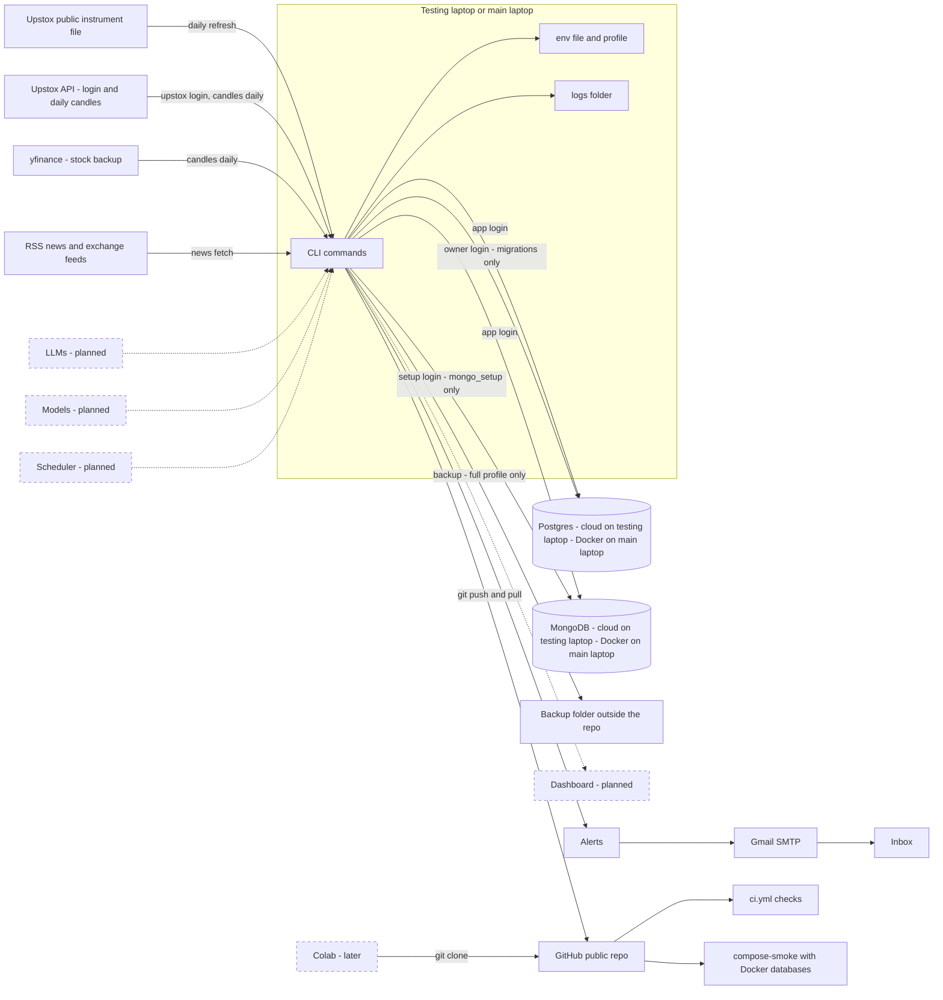
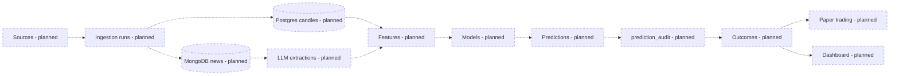

# Architecture

How market-intel works today, and what is planned. For day-to-day operation see the
[runbook](runbook.md); for why things are the way they are, see the [decision log](decisions.md).

## Overview

A command-line project in Python 3.12, run on one of two laptops (synced through git), with a
Postgres database and a MongoDB database. The testing laptop uses free cloud databases; the main
laptop runs both in local Docker containers (since task 0.9b). Nothing is scheduled yet: every
command runs only when started.

### Components now

Solid lines exist today. Dashed boxes and lines are **planned**.

### Planned data flow

Nothing in this diagram exists yet; it is the plan for Phases 1 to 9 (see
[Planned (later phases)](#planned-later-phases)).

### Commands

| Command | What it does |
|---|---|
| `python -m market_intel.config` | Prints the settings; secrets show only "set" or "not set" |
| `python -m market_intel.health` | The daily health check (see [Health check](#health-check)) |
| `python -m market_intel.db_check` | Connection, TLS, storage and write test for both databases |
| `python -m market_intel.compute_check` | CPU, RAM, disk and NVIDIA GPU of this machine |
| `python -m market_intel.alerts --test` | Sends one test alert email (`--dry-run` builds it only) |
| `alembic upgrade head` | Applies Postgres migrations (owner login) |
| `python -m market_intel.mongo_setup` | Creates or updates MongoDB collections (setup login) |
| `python -m market_intel.backup` | Backs up the local Docker databases (`--verify`: restore test); `full` profile only |
| `python -m market_intel.instruments refresh` | Refreshes NSE instruments from Upstox's public file (`--file`, `--dry-run`) |
| `python -m market_intel.instruments import-sectors PATH` | Sets sectors from the hand-downloaded Nifty 500 list CSV (`--dry-run`) |
| `python -m market_intel.watchlist add`, `remove`, `list` | The watchlist (max 50 stocks), stored only in the database |
| `python -m market_intel.news fetch` | Fetches the RSS news and exchange feeds into `news_items` (`--feed`, `--force`, `--dry-run`) |
| `python -m market_intel.news status` | Per-feed fetch and source-health status |
| `python -m market_intel.news company-fetch` | Per-company news from Google News RSS for the watchlist and recent filers (`--symbol`, `--force`, `--dry-run`) |
| `python -m market_intel.upstox login` | The daily Upstox login in the browser; the token goes to the credential store (`status`: valid / expired) |
| `python -m market_intel.candles daily` | Daily candles from Upstox (yfinance backup for stocks) with gaps and resume (`--universe`, `--from`, `--symbol`, `--dry-run`) |
| `python -m market_intel.features build` | Features v1 for the nifty500 (incremental; `--from` rebuilds) |
| `python -m market_intel.features labels` | Forward labels (21 / 63 / 126 days) with exclusion reasons |
| `python -m market_intel.features check-leakage` | The leakage test on the stored candles (`--sample N`) |
| `python -m market_intel.models train --horizon 21` | Walk-forward training, baselines after costs, holdout, final retrain, MLflow and registry |
| `python -m market_intel.models report` | The last training report (tables vs baselines) |
| `python -m market_intel.models ui` | The local MLflow UI on 127.0.0.1 |
| `python -m market_intel.candles special-sessions` | Lists special sessions and deletes their gap rows (`--dry-run`) |
| `python -m market_intel.features build` | Features v1 for the nifty500 (incremental; `--from` rebuilds) |
| `python -m market_intel.features labels` | Forward labels (21 / 63 / 126 days) with exclusion reasons |
| `python -m market_intel.features check-leakage` | The leakage test on the stored candles (`--sample N`) |
| `python -m market_intel.candles special-sessions` | Lists special sessions and deletes their gap rows (`--dry-run`) |
| `python -m market_intel.news rematch-exchange` | Matches stored exchange items to stocks again (BSE code, then name) |
| `python -m market_intel.news migrate-exchange-keys` | Recomputes the item keys of stored exchange items (`--dry-run`) |

All are run with `uv run` in front.

## Laptops and profiles

Each laptop's `.env` sets `APP_PROFILE`, named by what that machine may do:

| Profile | Used on | Databases | Broker keys | One-word hosts (Docker service names) |
|---|---|---|---|---|
| `restricted` | The testing laptop (now): testing and validation | Cloud only (it can't run Docker) | Not allowed (rule R1) | Not local: need TLS |
| `full` | The main laptop (from about 21 Nov 2026): main work | Local Docker (since 0.9b) | Allowed | Local |
| `server` | Later hosting | Docker allowed | Allowed | Local |

- The two laptops are used **alternately**, synced through git (see the
  [runbook](runbook.md#daily-routine)).
- The main laptop runs Postgres and MongoDB in local Docker containers (see
  [Databases](#databases) and the runbook's
  [Local Docker databases](runbook.md#local-docker-databases)). The testing laptop stays on the
  cloud databases until it is handed back.
- **Go live** only after validation.

## Configuration and profiles

Settings come from environment variables and one `.env` file per machine (never committed);
see `src/market_intel/config.py`.

- **Loading order:** real environment variables, then `.env` (found at the repo root, or the
  file named by `MARKET_INTEL_ENV_FILE`, e.g. in Docker), then the defaults in code.
- **Empty values mean "use the default"** (`KEY=` counts as not set), so a fresh copy of
  `.env.example` loads cleanly. `.env` only sets what differs.
- **Profiles** (`APP_PROFILE`): `restricted`, `full` or `server` (see
  [Laptops and profiles](#laptops-and-profiles)). The profile decides rule R1 and whether
  one-word hostnames count as local (see the TLS rule below). Any other value is refused with
  an error listing the allowed ones.
- **Groups:** settings are grouped (`database`, `database_admin`, `mongo_admin`, `upstox`,
  `llm`, `alerts`). A group is checked only when code that needs it calls
  `settings.require("<group>")`, which raises a clear error naming the missing variables. So
  the project starts with only `APP_PROFILE` set.
- **Secrets** are `SecretStr` values: they never appear in repr, dumps or error messages.
- **Rules checked at startup:**
  - **R1:** the `restricted` profile refuses to start if Upstox keys are set.
  - **R2:** `LLM_MONTHLY_CAP_INR` defaults to 1000. Above 1000 needs
    `LLM_CAP_RAISE_APPROVED=true`, after an approval logged in the decision log; above 2000 is
    always rejected.
  - **R3:** `LLM_WARN_PCT` must be between 1 and 99 (default 80).
- `DISPLAY_TIMEZONE` (default `Asia/Kolkata`) is used only when showing times; times are
  stored in UTC.

## Where data lives

| What | Where | In git? |
|---|---|---|
| Code, docs, tests | Public GitHub repo (source-available, see [LICENSE](../LICENSE.md)) | Yes |
| `.env` (secrets and machine settings) | Each laptop, copied by hand | **Never** |
| `docker/compose.env` (Docker database passwords) | The main laptop | **Never** |
| `logs/` | JSON log files on each laptop, one per component (`LOG_DIR`) | Never |
| `data/mlflow/`, `data/models/` | MLflow tracking (sqlite + artifacts), model files and cards | Never |
| `data/` | Local data and state, e.g. `data/state/alert_throttle.json` the downloaded instrument files in `data/raw/upstox/instruments/`, and the news feed and source-health state in `data/state/` (`DATA_DIR`) | Never |
| `drive_sync/` | Local folder for exports and backups | Never |
| Postgres tables | The Postgres database (see [Postgres schema v1](#postgres-schema-v1)) | No |
| MongoDB collections | The MongoDB database (see [MongoDB](#mongodb)) | No |
| Local database files (`full` profile) | Docker named volumes `market-intel_pgdata` and `market-intel_mongodata` on the main laptop | Never |
| Backups (`full` profile) | `BACKUP_DIR`: by default a `market-intel-backups` folder **next to** the repo folder; config refuses a folder inside the repo | Never |

**On the `full` profile** the databases are local: their data lives in the two Docker volumes
(containers are disposable; `docker compose down` keeps the volumes, `down -v` deletes them).
Once ingestion starts these volumes hold the only copy of the data, so backups are taken with
`market_intel.backup` and copied off the laptop (see the runbook's
[Local Docker databases](runbook.md#local-docker-databases)). On the `restricted` profile the
databases are the cloud services.

**Never in git:** market data, predictions, signals, model files, paper-trading results and
notebook outputs. `.gitignore` blocks the folders (`data/`, `models/`, `mlruns/`, `logs/`,
`outputs/`, `predictions/`, `signals/`, `reports/`, `backtests/`, `paper_trades/`) and data file
types (`.csv`, `.parquet`, `.feather`, `.h5`, `.db`, `.sqlite`, `.duckdb`, `.xlsx`, `.pkl`,
`.pt`, `.joblib`); only small synthetic files in `tests/fixtures/` are allowed.

## Security model

The repo is public, so this section stays general: no hosts, network rules or user names.

### Two logins per database

| Database | Login | Used by | Rights |
|---|---|---|---|
| Postgres | Owner (`POSTGRES_ADMIN_URL`) | Migrations only (on Docker the owner is the image's superuser, which `market_intel.backup` also uses inside the container, see below) | Owns the tables |
| Postgres | `mi_app` (`POSTGRES_URL`) | Everything else | SELECT, INSERT, UPDATE, DELETE on tables; USAGE on sequences; read-only `alembic_version`; TEMP. No CREATE, DROP, ALTER, TRUNCATE |
| MongoDB | Setup (`MONGODB_ADMIN_URI`) | `mongo_setup` and, on Docker, `market_intel.backup` (and cleaning up demo audits) | readWrite + dbAdmin on the database |
| MongoDB | App, role `mi_app_rw` (`MONGODB_URI`) | Everything else | Per named collection, see below |

Rights of the MongoDB role `mi_app_rw`:

| Collection | find | insert | update | remove |
|---|---|---|---|---|
| `news_items`, `llm_extractions` | yes | yes | yes | yes |
| `_healthcheck` | yes | yes | no | yes |
| `prediction_audit` | yes | yes | yes | **no** |

Plus listIndexes and collStats on these four, and database-wide listCollections, dbStats and
killAnyCursor. The app login can't create or drop collections or change indexes and
validators. Rights are per collection because MongoDB's insert right also creates a missing
collection; a database-wide insert would let a typo create a collection with no validator.

The local Docker databases have the same two logins per database, created by the init scripts
on first start. `market_intel.backup` runs the dump and restore tools **inside** the
containers, with the logins in the containers' own environment:

| Step | Postgres | MongoDB |
|---|---|---|
| Backup (counts and dump of `market_intel`) | The image's superuser over the container's local socket (no password) | The setup user |
| Restore test (create, restore into, count, drop `market_intel_restore_test`) | The superuser, only on the throwaway database | The root user, only on the throwaway database |
| Live counts shown by `--verify` (information only) | `mi_app` (`POSTGRES_URL`) | The app user (`MONGODB_URI`) |

MongoDB passwords reach `mongodump` and `mongorestore` only through a temporary config file
inside the container (written with shell builtins under `umask 077`, deleted on exit);
`mongosh` reads them from the container's environment inside its own process. No password
appears on a command line or in the output. MongoDB users and roles live in `admin` and are
not in the backup; on empty volumes the init scripts recreate them.

### TLS refusal

Every connection (the app, `db_check`, `health`, migrations and `mongo_setup`) goes through
`postgres.connect_url()` or `mongo.client_url()`. These refuse, **before sending anything**, to
reach a database that isn't local unless the connection string forces TLS:

- Postgres: `sslmode=require`, `verify-ca` or `verify-full`.
- MongoDB: `mongodb+srv://`, or `mongodb://` with `tls=true`.

**Local** means `localhost`, `127.0.0.1` or `::1` on every profile. A one-word hostname (a
Docker service name) counts as local only on the `full` and `server` profiles; on `restricted` it
could be any machine on the network, so it needs TLS.

### Secrets, masking and scanning

- Secrets live only in `.env` and `docker/compose.env`, both git-ignored; `.env.example` and
  `docker/compose.env.example` hold names with empty values (a test checks this).
- Logs and alert output mask: values of fields whose names look secret (`key`, `secret`,
  `password`, `token`, `uri`, `url`, ...), the whole user part of any URL (user name and
  password become `scheme://***@host`; decision 2026-11-22), and every secret value loaded
  from `.env`. Database error messages are also redacted; only hosts are shown.
  Alert recipients appear as `m***@domain`.
- Every commit runs detect-secrets (pre-commit). GitHub secret scanning and push protection
  are on. Safety tests fail if `.env` files, data folders, data file types, files over 1 MB or
  notebooks with outputs are tracked.

### Public repo and SEBI rules

- The repo holds **code and documentation only**: no market data, predictions, signals, model
  files, notebook outputs or paper-trading results.
- **Commit emails:** every commit must use the GitHub no-reply address (ending in
  `@users.noreply.github.com`), so no personal address is published.
  - Locally, the pre-commit hook `commit-email-guard` (`scripts/commit_email_guard.py`) blocks
    a commit whose author or committer email is anything else; it prints emails masked only.
  - In CI the hook is skipped; instead a test in `tests/test_repo_safety.py` checks every
    commit of the full history (commits made on github.com may have GitHub's own web-commit
    address as committer).
  - GitHub's own push block covers only addresses registered on the account, so the
    repo-side guard is still needed.
- Backups and dumps are data: they go to a folder outside the repo (`BACKUP_DIR`), never into
  git.
- The dashboard will run only on the owner's laptop with no other users; predicted-vs-actual
  results are shown only in person. Nothing public claims accuracy or returns.
- The disclaimer is in the README and in `market_intel.disclaimer.DISCLAIMER` (for the
  dashboard later). Signals only, never real orders.

## Databases

- **Testing phase (cloud):** Postgres 18 on Neon's free plan and MongoDB 8.0 on Atlas M0.
  Free-tier limits (checked 2026-11-13): Neon 1 GB storage, compute sleeps after 5 minutes
  idle (the first query after that is slower); Atlas M0 512 MB storage, about 100
  operations/second. `PG_STORAGE_LIMIT_MB` and `MONGO_STORAGE_LIMIT_MB` hold the limits.
- **`db_check`** shows, for each database: reachable, host (never user, password or URL),
  server version, latency (median of 3 pings), TLS (checked client-side), storage against the
  limit, a write test that leaves nothing behind, and unexpected MongoDB collections (as a
  warning). Exit code 0 when all is well, 1 otherwise. A failure or a TLS refusal sends a
  critical alert; storage at 80% or more sends a warning.
- **Docker on the main laptop (task 0.9):** `docker/compose.yaml` runs the same versions (postgres:18,
  mongo:8.0), with credentials from the git-ignored `docker/compose.env`. Ports listen on the
  local machine only. On first start, init scripts create the same logins as in the cloud:
  the Postgres app login `mi_app` (password `PG_APP_PASSWORD`), and the MongoDB role
  `mi_app_rw` with the app user and the setup user, all stored in `admin` (connect with
  `?authSource=admin`). Data persists in Docker volumes. To start it: copy
  `docker/compose.env.example` to `docker/compose.env`, fill in long random values, then run
  `docker compose -f docker/compose.yaml --env-file docker/compose.env up -d`.

## Postgres schema v1

Defined in `src/market_intel/db/schema.py` (SQLAlchemy Core) and created by Alembic migrations
in `migrations/` (0001 schema, 0002 grants for `mi_app`, 0003 trigger and TEMP grant, 0004
instrument seen dates, symbol reuse, symbol history and watchlist, 0005 BSE scrip codes, 0006
universe members and price events, 0007 features and labels, 0008 the model registry, 0009 feature builds).

| Table | Holds |
|---|---|
| `instruments` | One row per tradable symbol: exchange, segment, symbol, ISIN, Upstox key, BSE scrip code, sector, first and last seen dates |
| `instrument_symbol_history` | Every symbol change a refresh saw: old and new symbol, IST date |
| `watchlist` | The owner's watchlist (max 50 stocks, note up to 200 characters); its contents never go in the repo |
| `candles_daily` | Daily OHLCV per instrument and IST trading date, with source and raw/adjusted flag |
| `candles_intraday` | 1-minute bars only (start time in UTC); regular session only (S4i) |
| `ingestion_runs` | Every data-loading run: job, status, rows written, masked error |
| `data_gaps` | Missing data found per instrument and interval, and how it was resolved |
| `universe_members` | Which instruments belong to a named universe (`nifty500`, from the sector import), as of a date |
| `price_events` | Suspected split/bonus days found in the candles (ratio); prices are never changed |
| `features_daily` | Features v1 per instrument, trading day and feature version (one double column per feature) |
| `model_versions` | Every trained model version: name, sector or pooled, training range, holdout, metrics, beats_baseline, status (candidate / active / retired), MLflow run, model card |
| `labels_daily` | Forward returns over 21 / 63 / 126 regular trading days and up/down, or NULL with an exclusion reason; a separate table so features can never contain labels |
| `features_daily` | Features v1 per instrument, trading day and feature version (one double column per feature) |
| `labels_daily` | Forward returns over 21 / 63 / 126 regular trading days and up/down, or NULL with an exclusion reason; a separate table so features can never contain labels |
| `llm_spend` | Every LLM call's cost; the view `v_llm_spend_monthly` sums it per IST month |
| `feature_builds` | Each intraday feature or label build: kind, version, dates, rows, files and their SHA-256 (the files are Parquet under the data folder) |

Key rules:
- Timestamps are `timestamptz` in **UTC**; trading days are `date`, the **IST** exchange date.
- Prices are `numeric(14,4)`.
- Every candle row has a `price_basis` (`raw` or `adjusted`) and a `source` (`upstox` or
  `yfinance`). For the same day an Upstox row may replace a yfinance row, **never the
  reverse** (enforced by the Phase 1 loader).
- CHECK constraints guard OHLC ranges, non-negative volumes and allowed values; every
  constraint and index has a name from a naming convention. BRIN indexes cover the candle
  time columns. Tables are designed so they could become TimescaleDB hypertables later
  (plain Postgres for now).
- A trigger (`set_updated_at`) keeps `instruments.updated_at` current on every update.
- A symbol is unique per exchange and segment **among active instruments only** (a partial
  unique index, 0004), so a symbol can be reused after the old instrument goes inactive.
- `bse_code` (0005) is unique where set; most rows without a BSE listing stay NULL.
- `mi_app` gets its rights on new tables from the default privileges set in 0002; no
  migration grants rights by itself.

**Migration policy:** migrations never run automatically. They are applied by hand with the
owner login, only after CI is green (`alembic upgrade head`). Downgrades drop tables and data,
so they run **only in CI**, never on real data. CI also runs `alembic check` to prove
`schema.py` and the migrations match.

## MongoDB

The documents are Pydantic models in `src/market_intel/mongo/models.py`; collections,
validators and indexes are listed in `src/market_intel/mongo/schemas.py`. Every document has
`schema_version: 1`, and every time is stored in UTC.

| Collection | Holds | Unique key |
|---|---|---|
| `news_items` | One news item, exchange announcement or per-company article: source, feed, kind (`news`, `exchange` or `company_news`), publisher, URL, title, summary, `published_at` (with its source), `fetched_at`, **`available_at`** (when this system could know it), `exchange_meta`, `match_confidence` and `symbols` | `url_hash`, **the item key** (see below) |
| `llm_extractions` | Events an LLM read from one article (RBI action, results surprise, order win, sentiment, ...), with its `published_at` | `news_item_id` + `prompt_version` |
| `prediction_audit` | One record per prediction: inputs, model, SHAP reasons, news and LLM calls used, signal, and later the outcome | `prediction_id` |
| `_healthcheck` | Used only by `db_check`'s write test | |

- **Validators:** each collection has a `$jsonSchema` validator (`strict`, `error`) matching
  the models, with `additionalProperties: false`. A document with a missing field, a wrong type
  or an unknown field is rejected. So **run `mongo_setup` before code writes a new field.**
- **Indexes:** unique keys as above, plus time indexes (`published_at`, `available_at`,
  `kind` + `available_at`, `created_at`) for queries by time, kind, symbol, model and
  outcome status.
- **New fields (1.2):** `news_items` gained `kind`, `publisher`, `feed_name`,
  `available_at`, `published_at_source` and the optional `exchange_meta` object (its own
  `additionalProperties: false`). The model fills `available_at` and checks that it equals
  max(`published_at`, `fetched_at`); the validator requires it.
- **The item key (`url_hash`, 1.2b):** news and company news: sha256 of the normalised
  URL. Exchange items: sha256 of the normalised URL + "#" + the item's identity: the
  feed's guid if it has one, otherwise the normalised title + "|" + `published_at` (UTC
  ISO; the title alone when the time came from the fetch, so one filing keeps one key).
  Filings that share one PDF are therefore separate events. The NSE and BSE feeds have
  no guid today. Items stored before 1.2b were re-keyed once with
  `news migrate-exchange-keys` (update only, idempotent; a conflict leaves the item
  unchanged and is reported). 1.2b also added `kind = "company_news"` and the optional
  `match_confidence` (`high` / `low`).
- **`mongo_setup`** (setup login) is the only thing that creates collections, validators and
  indexes. It is idempotent: it creates what is missing, updates validators that changed
  (collMod) and prints a summary; a second run prints "nothing to change". It never drops a
  collection or an index, and if an index exists with a different definition it reports the
  conflict and changes nothing. It runs only when started by hand. It must run before the app writes anything: otherwise the app's first insert
  into one of the four collections would create it without a validator.
- **One access helper:** app code reaches collections only through
  `market_intel.mongo.access.collection(db, name)`, which accepts only the listed names and
  raises before contacting the database otherwise. `db_check` and `health` warn about
  collections that aren't in the list.
- **Append-only audits:** `market_intel.mongo.audit` is the only code that writes audits.
  `record_prediction` inserts once with outcome status `pending`; `record_outcome` adds the
  outcome once (`pending` -> `filled`), and a second call is refused. The database refuses
  deletes (no remove right). The app login does have update, which adding the outcome needs,
  so "only the outcome changes, and only once" is enforced in code.
- **Early leakage guard:** a prediction audit is refused if its `feature_cutoff` (the time of
  the latest data used) or the `published_at` of any news it used is later than the
  prediction time (`created_at`). The full leakage test comes in Phase 2.

## Logging and alerts

- **Logs, one file per component:** each program passes its name to `configure_logging`
  and writes only to `logs/<component>.jsonl` (folder from `LOG_DIR`): `health.jsonl`,
  `db_check.jsonl`, `backup.jsonl`, `mongo_setup.jsonl`, `alerts.jsonl`, and later one per job.
  Code that names no component writes to `market_intel.jsonl`. Component names are lower-case
  letters, digits and `_`.
  - One JSON object per line, timestamps in UTC. Each file starts anew at UTC midnight and
    keeps 30 days, **rotated independently**: two programs running at once never share (or
    lock) a file, which Windows' file locking would otherwise break at rotation time.
  - Masking (below) applies to every file and the console.
  - The console shows the same events in readable form, in `DISPLAY_TIMEZONE`. The level comes
    from `LOG_LEVEL` (`DEBUG`, `INFO`, `WARNING`, `ERROR`). Each run binds a `run_id` and
    `component` to its log lines.
- **Alerts** (`market_intel.alerts`): `info` is logged only; `warning` and `critical` are
  also emailed to `ALERT_EMAIL_TO` through Gmail SMTP.
  - **Non-blocking:** jobs call `queue_alert(...)`, which hands the alert to a background
    thread and returns at once. At exit the queue is flushed with a bounded wait (60 s);
    anything still queued then is logged as not sent. `send_alert(...)` still sends inline,
    for commands that want the result.
  - **Throttle:** the same alert (level + title, or an explicit `key`) is emailed at most once
    per `ALERT_THROTTLE_HOURS` (default 6, `0` = off). State is kept in
    `data/state/alert_throttle.json`. Suppressed alerts are still logged. The state is read
    and updated under a cross-process file lock, and the window is claimed before the email
    goes out (and given back if sending fails), so two programs alerting at the same moment
    send at most one email per window.
  - **Dry-run:** `ALERT_DRY_RUN=true` builds emails without sending them. Tests, demos and CI
    always use it.
  - A failed send is retried once after 5 s, then logged as an error; it never crashes the
    caller. Without alert settings, commands log `alerts_not_configured` and carry on.

## Data sources, rate limits and ingestion runs

Phase 1 groundwork (task 1.0). The first real source, Upstox's public instrument file, came
in 1.1 (see [Instruments and watchlist](#instruments-and-watchlist)); the others arrive in
tasks 1.2 to 1.7.

- **One interface** (`market_intel.sources.DataSource`): every source has a stable **source
  tag** and offers some of four kinds of data: instruments, daily candles, intraday candles,
  news. What it doesn't offer raises `NotSupportedError`. Sources only fetch and return
  records; they never write to a database.
- **Source tags:** `upstox`, `yfinance`, `rss:<feed>` (e.g. `rss:et_markets`), and `fake` for
  tests. Candle tables accept only `upstox` and `yfinance`, so fake candles can never be
  stored.
- **Typed records** (`market_intel.sources.records`): `Instrument`, `DailyCandle`,
  `IntradayCandle` and `NewsRecord` mirror the `instruments`, `candles_daily` and
  `candles_intraday` tables and the `news_items` collection. A record **can't be built without
  its source**, and values follow the tables' rules (price precision, OHLC ranges, volume,
  timezone-aware times, raw or adjusted prices), so a bad row fails before it reaches the
  database. `FakeSource` (`market_intel.sources.fake`) works end to end in tests.
- **Rate limiter** (`market_intel.rate_limit`): thread-safe, with several sliding windows at
  once, configured per source. Upstox defaults are its published per-user limits (50 per
  second, 500 per minute, 2000 per 30 minutes; `UPSTOX_RATE_*`), of which only a share is used
  (`UPSTOX_RATE_HEADROOM`, default 0.8 = 40 / 400 / 1600). On HTTP 429 or `Retry-After` it
  blocks every caller for an exponential delay plus jitter (at least `Retry-After`); a success
  resets it. The clock is injectable for tests.
  - **One process calls Upstox.** Upstox counts its limits per user, not per program, and a
    limiter only knows about its own process. So only **one process may call Upstox at a
    time**: from task 1.8 that is the scheduler. Running a second Upstox job by hand while the
    scheduler runs can exceed the limits.
- **Ingestion runs** (`market_intel.ingestion.ingestion_run`): every data-loading job runs
  inside this context manager.
  - On entry it inserts an `ingestion_runs` row (job, source, params, status `running`) with
    the **app login**, on its own autocommit connection, so the row is visible while the job
    runs and can still be marked failed if the job's own transaction breaks.
  - On success: `finished_at`, status `success` and `rows_written` (the job counts rows with
    `run.add_rows(n)`). A job whose parts partly failed calls `run.mark_partial(reason)`:
    the run ends `partial`, with the masked reason in `error` (from 1.2).
  - On any error, including Ctrl+C: status `failed`, `finished_at`, the rows counted so far
    and a **masked** error (`Type: message`, with the whole user part of URLs and loaded
    secrets removed, the same rule as logs, at most 2000 characters); then the exception is
    re-raised unchanged. Secret-looking params are masked before they're stored.
  - Health's `data_freshness` check reads the latest row.

## Instruments and watchlist

Task 1.1 (decision 2026-11-22). Commands: `market_intel.instruments` and
`market_intel.watchlist`; each logs to its own file (`logs/instruments.jsonl`,
`logs/watchlist.jsonl`).

- **Source:** Upstox's public instrument file for NSE (`NSE.json.gz`, no login, refreshed daily
  around 06:00 IST; `UPSTOX_INSTRUMENTS_URL`). It uses the same `instrument_key` as Upstox's
  candle API. Module: `market_intel.sources.upstox_instruments`.
- **Download:** a conditional GET (ETag / If-Modified-Since; "not modified" means nothing to
  do), a timeout and the User-Agent `market-intel`. The file is saved as
  `data/raw/upstox/instruments/NSE-<YYYYMMDD>.json.gz` and the newest 7 are kept. The ETag is
  remembered only after the database refresh has committed, so a refused or failed refresh
  downloads in full next time.
- **Untrusted file:** compressed size at most 50 MB; stream-decompressed with a hard 300 MB
  cap; parsed with the `json` module only, never executed or evaluated. Each kept object is
  validated into an `Instrument` record tagged `upstox`; malformed objects (and duplicates)
  are skipped and counted.
- **BSE scrip codes (1.2b):** the refresh also downloads Upstox's public `BSE.json.gz`
  (`UPSTOX_BSE_INSTRUMENTS_URL`; same conditional GET, size caps and untrusted-data rules;
  saved as `BSE-<YYYYMMDD>.json.gz` with its own validators). From segment `BSE_EQ` it
  maps ISIN -> scrip code (the file's `exchange_token`, a 6-digit code; checked against
  BSE's own feed) onto NSE stocks by ISIN, in its own transaction, with the same safety
  valve. If only the BSE part fails, the NSE refresh still counts and the run is
  `partial`. With `--file` the BSE part is skipped unless `--bse-file` is given.
- **Filter:** NSE stocks (segment `NSE_EQ`) of series EQ and BE, and every NSE index
  (`NSE_INDEX`). Everything else is skipped and counted by segment. Stored as exchange `NSE`,
  segment `EQ` or `INDEX`, series = the file's `instrument_type` (NULL for indices). Upstox
  gives tick sizes in paise; the table stores rupees.
- **Refresh rules** (`instruments refresh`, inside `ingestion_run(job="instruments_refresh",
  source="upstox")`, one transaction with the app login):
  - Keyed by `instrument_key`. New rows get `first_seen_on`; every listed row gets
    `last_seen_on` = today (IST). Rows are updated only when something changed, so a second
    run on the same file makes 0 changes (`last_seen_on` alone isn't counted as a change).
  - A changed symbol writes an `instrument_symbol_history` row.
  - Instruments missing from the file become **inactive**. Rows are never deleted and
    `delisted_on` stays NULL, because absence isn't proof of delisting. A listed inactive
    instrument becomes active again.
  - Order of writes: missing rows and rows changing symbol go inactive first, then the
    updates, then the inserts, so the unique index on active symbols holds even when two
    symbols swap.
  - **Safety valve:** if the file keeps fewer than `INSTRUMENTS_MIN_KEEP_RATIO` (default 0.8)
    x the currently active instruments, and some are active, nothing changes: the run is
    marked failed and a WARNING alert "Instrument refresh refused: file too small" is queued.
  - The summary shows inserted, updated, symbol changes, deactivated, reactivated, skipped by
    segment and malformed, plus the counts of EQ, BE and indices. `--dry-run` downloads in
    full, rolls everything back and records no run. `--file` uses a local file instead.
- **BE stocks** (trade-to-trade, often under exchange surveillance, riskier) are flagged, not
  hidden.
- **Sectors** (`instruments import-sectors PATH`): the owner downloads the "Nifty 500" list
  CSV from the NSE Indices website by hand (no scraping, no automated download). The headers
  must be exactly `Company Name, Industry, Symbol, Series, ISIN Code`; otherwise nothing
  changes. Rows match active NSE stocks by ISIN (fallback: symbol with series EQ); `sector` =
  the CSV's Industry value (NSE's broad classification). Empty values never overwrite. Stocks
  outside the Nifty 500 have no sector.
- **Watchlist** (`watchlist add SYMBOL [--note TEXT] | remove SYMBOL | list`): active NSE
  stocks of series EQ or BE only (indices are refused), at most 50 (the 51st is refused; a
  short table lock makes the check race-free), with a note of up to 200 characters. Adding a
  BE stock prints a risk note. The list lives **only in the database**: never in the repo or
  the docs, and the log records counts only. Choosing stocks is the owner's decision; the
  system doesn't recommend.

## News and exchange feeds

Task 1.2 (decisions 2026-11-22: legitimate channels only; news and exchange feeds). Command:
`market_intel.news` (`fetch`, `status`); logs to `logs/news.jsonl`.

- **Feeds:** `config/news_feeds.toml` (committed; `NEWS_FEEDS_FILE`): 6 news feeds (Economic
  Times, Mint, Business Standard) and 5 official exchange feeds (NSE announcements, financial
  results, board meetings, insider trading; BSE announcements). Each has a name, URL, kind
  (`news` or `exchange`), publisher, `min_interval_minutes` (default 10) and `enabled`.
  Moneycontrol is excluded (it blocks non-browser clients).
- **Polite fetching** (`market_intel.sources.rss`, httpx): the honest user agent
  `market-intel/<version> (personal research; RSS reader)`, never a browser's; timeouts; a
  size cap (`NEWS_FETCH_MAX_BYTES`, default 5 MB); conditional requests (ETag /
  Last-Modified); at most one request per feed per `min_interval_minutes` (`--force` ignores
  that). A 403, 429 or 5xx is recorded as a failure, `Retry-After` is respected (even by
  `--force`), and the request is never repeated with another identity. **Item links are never
  followed**: no article pages, no PDF downloads. Per-feed fetch state (validators, times,
  Retry-After) is in `data/state/news_feeds.json`, written atomically under a file lock.
- **Parsing:** feedparser on the fetched bytes (never a URL). Title (HTML stripped, at most 500
  characters), summary (HTML stripped, at most 2000) and link. The URL is normalised and its
  sha256 is `url_hash`; an item already stored keeps its **first** document unchanged.
  Entries without a link or title are counted as malformed.
- **Timing fields** (leakage safety): `published_at` is the feed's date in UTC; if missing, the
  fetch time (`published_at_source = "fetched"`); if more than 5 minutes in the future, the
  fetch time (`"clamped"`); otherwise `"feed"`. Exchange feeds give IST times without a zone
  ("21-Nov-2026 18:30:00"), which are read as IST. `fetched_at` is when we first fetched the
  item; **`available_at` = max(`published_at`, `fetched_at`)** is when this system could know
  it, and Phase 2 features use `available_at`.
- **Exchange items:** `exchange_meta` keeps what the feed says (exchange, raw company name, the
  exchange's own code where given: BSE's scrip code, subject, attachment URL; never
  downloaded). `symbols` is set only on a **clear match** with an active NSE stock: the exact
  NSE symbol, the stock's BSE scrip code for BSE items (1.2b), or exactly one stock with the
  same normalised company name (case, punctuation,
  "&"/"and", "Ltd"/"Limited" ignored). Ambiguous or no match: `symbols = []`, counted in the
  summary. News items get `symbols = []`; Phase 2 extracts companies.
- **Runs:** one `ingestion_run(job="news_fetch", source="rss")`; `rows_written` = new
  documents. All attempted feeds OK (or skipped) -> `success`; some failed and at least one
  OK -> `partial`, with the failed feeds named; all attempted failed -> `failed`.
  `--dry-run` fetches and parses but saves nothing (no documents, state, health or run).
- **`news status`:** per feed: last fetch, last success, items in the last content fetch,
  consecutive failures, documents stored and active source-health problems.

## Source health

`market_intel.source_health`, reusable by every source (RSS from 1.2; later files and APIs).
Each attempt is reported as a failure, "not modified" or content (usable, malformed and
undated item counts). State is in `data/state/source_health.json` (counts and masked error
text only), written atomically under a file lock.

| Rule | Fires when |
|---|---|
| `failures` | 3 consecutive failures |
| `empty` | content arrived but 0 items were parsed: the body wasn't a recognisable feed, or every entry was unusable (a well-formed feed that is simply empty is not a problem) |
| `malformed` | more than 50% of entries had no link or title |
| `volume_drop` | fewer items than 20% of the median of the last 10 content fetches (only after 5 or more, and only if that median is above 0) |
| `no_publish_time` | more than 50% of usable items had no publish time (the date format probably changed) |
| `silent` | 0 items in every content fetch of the last 14 days (only once the source has 14 days of content history; 1.2b) |
| `blocked` | the source refused automated access (Google News; alert titled "google_news blocked"); cleared by the next successful fetch |

Each rule queues one WARNING alert per source and rule, throttled by the alert throttle
(`ALERT_THROTTLE_HOURS`). The alert names the source, the rule, the masked last error and the
next step: "the source may have changed: update config/news_feeds.toml or the parser". A rule
stays an **active problem** until a later attempt passes it; health's `sources` check is WARN
while an enabled source has one, SKIP before any fetch, otherwise OK.

## Per-company news (Google News RSS)

Task 1.2b (decision 2026-11-22). Command: `market_intel.news company-fetch`
(`market_intel.sources.google_news`); logs to `logs/news.jsonl` (counts only, never symbols).

- **Targets:** every watchlist stock, plus up to `GOOGLE_NEWS_FILERS_CAP` (default 30)
  **recent filers**: distinct matched symbols of exchange items with `available_at` in the
  last 24 hours, newest first, not on the watchlist. `--symbol SYM` fetches one active NSE
  stock instead.
- **Query:** `GOOGLE_NEWS_RSS_URL?q="<clean name>" when:2d&hl=en-IN&gl=IN&ceid=IN:en`, URL
  encoded. The clean name is `instruments.name` without Limited/Ltd/Ltd. and a leading "The",
  spacing normalised. Checked 2026-11-22: an RSS 2.0 feed (title, link, guid, pubDate, an HTML
  description, `<source>` = the publisher); no ETag or Last-Modified, so no conditional
  requests.
- **Politeness:** one request per `GOOGLE_NEWS_MIN_SECONDS` (default 10) across the process (a
  `RateLimiter`); each company at most once per `GOOGLE_NEWS_COMPANY_INTERVAL_MINUTES`
  (default 60; `--force` ignores this); the honest user agent; redirects are not followed;
  the Google item links are stored, never opened. State: `data/state/google_news.json` (each
  company's last fetch and the block pause).
- **Block handling:** HTTP 403, 429 or 503, a body that isn't a feed (an HTML page), or a
  redirect to a consent, "sorry" or CAPTCHA page **stops the round at once**. No Google request
  is made until the next IST day (not even with `--force`), one source-health alert
  "google_news blocked" is queued, and the run is `partial` (or `failed` if nothing was
  fetched). Nothing is retried and the identity never changes. Rounds during the pause make
  no request and end `success` with 0 rows; health's `sources` shows the block.
- **Storage:** `news_items` with `kind = "company_news"`, `feed_name = "google_news"`,
  `source = "google_news"`, `publisher` = the item's `<source>`, the Google link as given,
  title and summary (HTML stripped, same caps), the same time rules
  (`published_at` / `fetched_at` / `available_at`), `symbols = [target]` and
  **`match_confidence`**: `low` if the clean name is one word or doesn't appear in the title
  or summary (case-insensitive), otherwise `high`. An article already stored for another
  company gains that symbol with `$addToSet`; nothing else changes.
- **Runs:** one `ingestion_run(job="company_news", source="google_news")`; `rows_written` =
  new documents; `partial` if some companies failed or a block stopped the round after
  something was fetched. Source health treats `google_news` as one source (all rules, plus
  `blocked`).

## Upstox login and daily candles

Sprint task S1 (decisions 2026-11-24). Commands: `market_intel.upstox` (`login`, `status`;
logs to `logs/upstox.jsonl`) and `market_intel.candles daily` (`logs/candles.jsonl`).

- **Login** (Upstox's authorization-code flow, checked 2026-11-24): `upstox login` opens
  `https://api.upstox.com/v2/login/authorization/dialog` with `client_id`, `redirect_uri`,
  `response_type=code` and a random `state`; the owner logs in on Upstox's own page (this code
  never sees the password or TOTP, and never automates the page). A one-request server on
  127.0.0.1 (the port and path of `UPSTOX_REDIRECT_URI`) waits at most 3 minutes for the
  callback and checks `state`; otherwise the owner pastes the address from the browser bar. The
  single-use code is exchanged at `/v2/login/authorization/token` (form body). The approve-on-
  phone flow isn't used (it needs a public webhook). Refused on the `restricted` profile (R1).
- **Token:** stored ONLY in the operating system's credential store (Windows Credential
  Manager, via `keyring`, service `market-intel-upstox`). Non-secret metadata (`issued_at`,
  `expires_at` = the next 03:30 IST, when Upstox tokens end) is in
  `data/state/upstox_token.json`. The token is never printed or logged: it is added to log
  masking as soon as it is loaded. `upstox status` shows valid / expired and the hours left.
- **API client** (`UpstoxClient`): GET only (no order APIs), the Bearer token, the honest user
  agent and the process-wide Upstox rate limiter (80% headroom, 429 back-off). HTTP 401 raises
  `TokenExpired` ("run: upstox login") and queues one throttled WARNING alert "Upstox token
  expired". Health's `upstox_token` check: OK while valid; WARN if missing, expired or under 1
  hour left; SKIP while the upstox settings aren't set.
- **Upstox candles** (`market_intel.sources.daily_candles`):
  `GET /v3/historical-candle/{instrument_key}/days/1/{to}/{from}` (dates inclusive, at most one
  decade per request, so ranges are split into 9-year chunks). Candles are
  `[timestamp (+05:30), open, high, low, close, volume, oi]`; the IST date is the trade date.
  Records: `source = "upstox"`, `price_basis = "raw"`. Seen in the first backfill
  (2026-11-24): for many indices Upstox returns a 2017-2018 day twice (a 00:00 and a 09:15 or
  17:30 candle); the 00:00 candle is kept and the rest are counted as duplicates. Rows that break
  the OHLC range (mostly government-bond indices) are skipped and their days stay as gaps. An
  instrument Upstox rejects as an invalid key (`UDAPI1021`, `UDAPI100011`; e.g. the BHARATBOND
  indices) is reported as "not served by Upstox", not as a failure.
- **yfinance backup** (stocks only, `<SYMBOL>.NS`): used only when Upstox fails for an
  instrument and range, or no valid token exists; `auto_adjust=False` (raw prices), `end`
  exclusive. yfinance normally impersonates a browser; this project always passes its own
  `requests` session with the honest user agent, so Yahoo may refuse it. After 5 failures in
  a row it is switched off for the rest of the run. One request per 2 seconds. Indices load
  from Upstox only.
- **Loader** (`candles daily [--universe indices|nifty500|watchlist|all] [--from DATE]
  [--symbol S] [--dry-run]`):
  - **Universes:** `indices` = all active NSE indices except the BHARATBOND ones (S2); `nifty500` = `universe_members`
    (written by the sector import: today's Nifty 500 list); `watchlist`; `all` = their union.
    Nifty 50 is always loaded first: its candle days are the **trading calendar**, minus
    special sessions (from S2; see
    [Features, labels and the leakage test](#features-labels-and-the-leakage-test)).
  - **Incremental:** from each instrument's last stored day + 1 up to the last trading day
    (today after 18:00 IST, otherwise yesterday); `--from` also loads earlier history (an empty
    instrument starts at 2015-01-01). Days stored from yfinance are asked from Upstox again
    whenever a token exists.
  - **Precedence:** one upsert per instrument; for the same day an `upstox` row may replace a
    `yfinance` row, never the reverse; unchanged rows aren't rewritten (a rerun writes 0).
  - **Gaps:** calendar days between an instrument's first candle and the last trading day
    without a candle. Stocks first retry them with one yfinance request; what remains becomes
    `data_gaps` rows (interval `1d`, one per run of missing days): `unfillable` once every
    source available for the instrument has failed (stocks: Upstox and yfinance; indices:
    Upstox), otherwise `open`. Open gaps are retried on the next run and become `filled` when
    all their days are present.
  - **Resumable:** `data/state/candles_progress.json` records the instruments finished for
    the current target day; a rerun skips them, so an interrupted backfill continues.
  - **Suspected split/bonus:** a day-over-day close ratio within 3% of 1/2, 1/3, 1/4, 1/5,
    1/10, 2/3 or 4/5 while Nifty 50 moved less than 5% -> a `price_events` row
    (`suspected_split_bonus`, the ratio). Prices are never changed; S2 excludes these days
    from labels.
  - **Runs:** one `ingestion_run(job="candles_daily", source="upstox")`; `rows_written` = rows
    inserted or changed; `partial` if some instruments failed, `failed` if all did. Source
    health: `upstox_candles` and `yfinance_candles` (one report per source per run:
    instruments OK vs failed).
- **Survivorship bias:** today's Nifty 500 is used for the whole history, so companies that
  dropped out are missing and results look better than reality; model cards must say so.
- **Exchange rematch:** `news rematch-exchange` sets stored exchange items' `symbols` again by
  BSE code, then by name (only `symbols` changes, only where different).

## Features, labels and the leakage test

Sprint task S2 (decisions 2026-11-24). Command: `market_intel.features` (`build`, `labels`,
`check-leakage`); logs to `logs/features.jsonl`. Column lists: `market_intel.feature_spec`
(one list shared by the schema, the builder and the leakage test).

**Timing convention** (enforced in code and by the leakage test):

- The features for trading day t use ONLY candles up to and including t's close.
- `prediction_time(t)` = 08:30 IST on the next weekday after t. A holiday calendar isn't
  available; on a holiday this cutoff is earlier than the real next session, never later.
- Entry is at `open(t+1)`, the next regular trading day's open.
- News features use only items with `available_at <= prediction_time(t)`.

**Regular sessions:** a **special session** is a calendar (Nifty 50) day on which fewer than 50%
of the nifty500 members that already had history have a candle (e.g. Diwali Muhurat trading,
a Budget-day Saturday; 2 days so far). Special sessions are removed from every candle series
before features are computed, are not label days, and are not part of the loader's gap
calendar (`candles special-sessions` lists them and deletes their gap rows). The 4 BHARATBOND
indices are not in the `indices` universe (Upstox doesn't serve them); bond indices keep their
valid rows but no feature or model uses them.

**Features v1** (`features_daily`, one double column each; PK instrument, day, version; one
pure function `build_features(candles, market, sector)` that never reads the database):

| Group | Features |
|---|---|
| Returns | log returns over 1, 5, 20, 60, 120 days |
| Volatility | std of daily log returns over 20 and 60 days; ATR14 / close |
| Trend | close / SMA20, SMA50, SMA200 - 1; SMA20 / SMA50 - 1 |
| Momentum | RSI14 (Wilder smoothing) |
| Volume | z-score of log(1 + volume) vs 20 days; log of the 20-day mean traded value |
| 52 weeks | close / 252-day max high - 1; close / 252-day min low - 1 |
| Gap | open / previous close - 1 |
| Relative strength | ret_20d minus Nifty 50 ret_20d; minus the sector's equal-weight ret_20d (nifty500 members of the same sector, from our own candles) |
| Market | Nifty 50 r5, r20, close / SMA200 - 1; India VIX level and 5-day change |
| Calendar | day of week, month |
| Flags | history_days; a suspected split/bonus in the last 5 days |
| News (**not for training** yet) | exchange items over 1 and 5 prediction windows; company news over 5 |

Every rolling window looks back only and needs its full length (otherwise NULL). Instruments
with under 252 days of history are still stored (with `history_days`), so S3 can filter and
warn. `build` is incremental (new days per instrument; `--from` rebuilds from a day) and
bulk-loads with COPY inside an ingestion run (`features_build`).

**Labels** (`labels_daily`, a SEPARATE table, so a feature row can never hold a label):
`fwd_return(h) = close(t+h) / open(t+1) - 1` over h REGULAR trading days, h = 21, 63, 126;
`up = fwd_return > 0`. NULL with `excluded_reason` when the window (t, t+h] runs past the data
(`beyond_data`), contains a special session (`special_session`), a suspected split/bonus
(`price_event`) or a calendar day without the stock's candle (`gap`). A database check makes a
row either a label or a reason. `labels` recomputes every label of the universe (labels change
as new candles arrive), inside an ingestion run (`labels_build`).

**Leakage test** (`check-leakage`; also in CI on synthetic data, where any failure fails the
build): on sampled (instrument, day) pairs,

- a) **truncation:** features for t from the full history equal features after deleting every
  candle (all instruments, market, events) after t and every news item after
  `prediction_time(t)`;
- b) **late news:** adding or moving news after `prediction_time(t)` changes no feature for t;
- c) **label names:** no feature name is or contains a label word, and the builder never
  mentions the labels;
- d) **shifted data:** changing candles after t changes no feature for t; changing candles up to
  t changes no label for t; changing candles after t changes an unexcluded label.

Unit tests feed deliberately leaky features (tomorrow's close, a centred moving average, news
from any time, a label-named feature, a builder that calls the label code) and require the
test to catch each one. The test only catches the patterns it checks, so every new feature must
go through `build_features`.

## Features, labels and the leakage test

Sprint task S2 (decisions 2026-11-24). Command: `market_intel.features` (`build`, `labels`,
`check-leakage`); logs to `logs/features.jsonl`. Column lists: `market_intel.feature_spec`
(one list shared by the schema, the builder and the leakage test).

**Timing convention** (enforced in code and by the leakage test):

- The features for trading day t use ONLY candles up to and including t's close.
- `prediction_time(t)` = 08:30 IST on the next weekday after t. A holiday calendar isn't
  available; on a holiday this cutoff is earlier than the real next session, never later.
- Entry is at `open(t+1)`, the next regular trading day's open.
- News features use only items with `available_at <= prediction_time(t)`.

**Regular sessions:** a **special session** is a calendar (Nifty 50) day on which fewer than 50%
of the nifty500 members that already had history have a candle (e.g. Diwali Muhurat trading,
a Budget-day Saturday; 2 days so far). Special sessions are removed from every candle series
before features are computed, are not label days, and are not part of the loader's gap
calendar (`candles special-sessions` lists them and deletes their gap rows). The 4 BHARATBOND
indices are not in the `indices` universe (Upstox doesn't serve them); bond indices keep their
valid rows but no feature or model uses them.

**Features v1** (`features_daily`, one double column each; PK instrument, day, version; one
pure function `build_features(candles, market, sector)` that never reads the database):

| Group | Features |
|---|---|
| Returns | log returns over 1, 5, 20, 60, 120 days |
| Volatility | std of daily log returns over 20 and 60 days; ATR14 / close |
| Trend | close / SMA20, SMA50, SMA200 - 1; SMA20 / SMA50 - 1 |
| Momentum | RSI14 (Wilder smoothing) |
| Volume | z-score of log(1 + volume) vs 20 days; log of the 20-day mean traded value |
| 52 weeks | close / 252-day max high - 1; close / 252-day min low - 1 |
| Gap | open / previous close - 1 |
| Relative strength | ret_20d minus Nifty 50 ret_20d; minus the sector's equal-weight ret_20d (nifty500 members of the same sector, from our own candles) |
| Market | Nifty 50 r5, r20, close / SMA200 - 1; India VIX level and 5-day change |
| Calendar | day of week, month |
| Flags | history_days; a suspected split/bonus in the last 5 days |
| News (**not for training** yet) | exchange items over 1 and 5 prediction windows; company news over 5 |

Every rolling window looks back only and needs its full length (otherwise NULL). Instruments
with under 252 days of history are still stored (with `history_days`), so S3 can filter and
warn. `build` is incremental (new days per instrument; `--from` rebuilds from a day) and
bulk-loads with COPY inside an ingestion run (`features_build`).

**Labels** (`labels_daily`, a SEPARATE table, so a feature row can never hold a label):
`fwd_return(h) = close(t+h) / open(t+1) - 1` over h REGULAR trading days, h = 21, 63, 126;
`up = fwd_return > 0`. NULL with `excluded_reason` when the window (t, t+h] runs past the data
(`beyond_data`), contains a special session (`special_session`), a suspected split/bonus
(`price_event`) or a calendar day without the stock's candle (`gap`). A database check makes a
row either a label or a reason. `labels` recomputes every label of the universe (labels change
as new candles arrive), inside an ingestion run (`labels_build`).

**Leakage test** (`check-leakage`; also in CI on synthetic data, where any failure fails the
build): on sampled (instrument, day) pairs,

- a) **truncation:** features for t from the full history equal features after deleting every
  candle (all instruments, market, events) after t and every news item after
  `prediction_time(t)`;
- b) **late news:** adding or moving news after `prediction_time(t)` changes no feature for t;
- c) **label names:** no feature name is or contains a label word, and the builder never
  mentions the labels;
- d) **shifted data:** changing candles after t changes no feature for t; changing candles up to
  t changes no label for t; changing candles after t changes an unexcluded label.

Unit tests feed deliberately leaky features (tomorrow's close, a centred moving average, news
from any time, a label-named feature, a builder that calls the label code) and require the
test to catch each one. The test only catches the patterns it checks, so every new feature must
go through `build_features`.

## Intraday data, features and labels

Sprint task S4i (decisions 2026-11-25). Commands: `market_intel.candles intraday` (1-minute
candles) and `market_intel.intraday` (`features build`, `labels build`, `check-leakage`); logs
to `logs/candles.jsonl` and `logs/intraday.jsonl`.

**1-minute candles** (`candles_intraday`, interval `1m`, `ts` = bar start in UTC):

- Instruments: the `nifty50` universe (from `instruments import-sectors --universe nifty50`),
  the Nifty 50 index, India VIX and the NSE sector indices that match the members' sectors
  (`intraday_candles.SECTOR_INDEX`; Power uses Nifty Energy and Construction Nifty Infra as the
  closest; Telecommunication, Capital Goods and Consumer Services have no sector index).
- Upstox V3 historical candles, `minutes/1`, one calendar month per request (the documented
  maximum), from January 2022 (the earliest Upstox serves). Upstox only: there is no backup
  source for minutes.
- Resumable: complete past months are recorded per instrument in
  `data/state/intraday_progress.json`; a rerun starts after the last stored day. Each month is
  COPY-ed into a temporary table and upserted on the primary key (`source = 'upstox'`,
  `price_basis = 'raw'`); unchanged bars are not rewritten.
- Regular session only: bar starts 09:15-15:29 IST. Other bars are dropped and counted, and so
  are special-session days (S2 rules) and invalid OHLC rows.
- A **thin day** is a day with fewer than 300 bars for an instrument: a `data_gaps` row with
  interval `1m`, status `unfillable` and the note "thin day: N bars".
- Source health name: `upstox_intraday`. A run with some failed months is `partial`.

**Timing convention** (enforced in code and by the leakage test):

- Decision points every 5 minutes from 09:30 to 15:00 IST (bar starts; 67 a day).
- The features at decision bar t use ONLY bars up to and including t (closed), daily candles
  up to the previous trading day, and price events up to the previous trading day.
- Entry is at the OPEN of bar t+1.
- Every position closes by the close of the 15:20 bar.

**Features v1** (`intraday.FEATURES_V1`, pure functions over each day's bars; groups as in the
build summary):

| Group | Features |
|---|---|
| returns | log returns over 1, 5, 15, 30 minutes (within the day), since the day's open; the overnight gap (open vs the previous daily close) |
| vwap | distance from the session VWAP up to t; VWAP change over 15 minutes |
| opening range | position in the first 15 / 30 minutes' range and breakout flags; NaN until the range is complete (09:29 / 09:44 bar closed) |
| volume | bar volume and cumulative volume vs the average at the same minute over the previous 20 days (at least 10; previous days only) |
| volatility | standard deviation of 1-minute returns over 15 / 30 minutes; range so far / open |
| relative strength | return since the open and over 15 minutes minus Nifty 50's and minus the sector index's (NaN without a sector index) |
| market | Nifty 50 return since the open and over 15 minutes; India VIX at t (1-minute; else the previous daily close) |
| previous day | from daily candles before t's day: return, range, distance of the price from the previous high and low, ATR14 / close |
| time and flags | minutes since 09:15, day of week, a price event on the previous trading day, `thin_so_far` (fewer than 80% of the bars expected by t) |
| rule signals (for S5i) | ORB (15-minute) breakout up/down crossings, VWAP cross up/down, volume burst (3x the time-of-day normal), gap bucket (-2..2 at -1%, -0.3%, 0.3%, 1%) |

A price event on t's own day is not a feature: our split/bonus detector uses that day's
close, so it isn't known at t. Such days are excluded from the labels instead.

**Labels (triple barrier)** for each decision point and both sides: entry = open(t+1); the path
is bars t+1 .. min(t + `INTRADAY_MAX_BARS`, the 15:20 bar). Long: +1 if the high reaches
entry x (1 + `INTRADAY_TARGET_PCT`%) first, -1 if the low reaches entry x (1 -
`INTRADAY_STOP_PCT`%) first, 0 at the time limit; short is the mirror. If one bar touches
both, the stop counts first. The gross return is the barrier (+target or -stop) or, at the time
limit, the last bar's close vs the entry. Defaults 0.5%, 0.25%, 15 bars (settings; names in
`.env.example`). Excluded with a reason: `special_session`, `price_event` (the event day and
the next trading day), `thin_day` (fewer than 300 bars) and `no_entry` (no bar at t+1).

**Storage:** Parquet (zstd), one file per month: `DATA_DIR/features/intraday/v1/year=YYYY/
month=MM/part-0.parquet` and `DATA_DIR/labels/intraday/v1/...` (git-ignored). Each build is
a `feature_builds` row (migration 0009): kind, version, date range, rows, files and the
SHA-256 of every file written. Builds are incremental from the month of the last build (a
month is rewritten whole); `--from YYYY-MM` rebuilds from that month. Candles stay in
Postgres.

**Leakage test** (`intraday check-leakage`; also a 10-sample gate at the start of every build,
which then refuses to write): (a) truncation: features at t are unchanged after deleting every
bar after t; (b) multiplying bar t's volume by 10 multiplies `vol_rel_tod` by exactly 10, so
the time-of-day baseline uses only previous days; (c) opening-range features are NaN before
the range completes; (d) the label's entry is the open of bar t+1, and changing any bar up to t
changes no label; (e) no feature name looks like a label. The unit tests feed deliberately
leaky fakes (the next bar's close, a centred average, today's full-day volume, entry at bar
t's close) and require each to be caught.

## Models, evaluation, costs and the registry

Sprint task S3 (decisions 2026-11-24). Command: `market_intel.models` (`train`, `report`, `ui`);
logs to `logs/models.jsonl`. Modules: `market_intel.evaluation` (folds, metrics, portfolio),
`market_intel.costs`, `market_intel.explain` (SHAP), `market_intel.models` (training, MLflow,
registry).

- **Target and rows:** horizon 21 trading days; a LightGBM **classifier** (up/down) and
  **regressor** (forward return) per model. Training rows: features v1 except the news counts
  (not for training) + 21-day labels that exist, stocks with at least 252 days of history
  (thinner stocks are excluded from training; their later predictions must say "thin data").
- **Per-sector vs pooled:** one model per sector with at least 20,000 training rows and 8
  stocks (decided on the rows before the holdout); the other sectors share ONE **pooled** model
  (all sectors, sector as a categorical feature), flagged "pooled fallback" in its card. In a
  fold where a sector has under 2,000 training rows, its stocks use the pooled model.
- **Fixed settings, no tuning:** 200 trees, learning rate 0.05, 31 leaves, at least 200 rows
  per leaf, 80% row and column sampling, L2 1.0, `deterministic`, seed 42.
- **Walk-forward:** yearly test folds from 2018 (plus the part of the holdout's year before
  it), expanding window. **Purge:** a training row's label window (t, t+21] must end before the
  test fold starts. **Embargo:** rows in the 21 trading days after an earlier test fold don't
  train later folds. A fold without training rows is left out.
- **Holdout:** the last 6 months of usable 21-day labels, evaluated ONCE after all folds, with
  a model trained on everything allowed before it; reported separately and never used for a
  choice. Then every model is retrained on ALL usable rows: the S4 **candidate**.
- **Baselines** (same folds, dates and costs): always-up (everything predicted up, so its
  portfolio is the equal-weight universe), momentum (score = past 21-day return), SMA rule
  (close > SMA50; score = close / SMA50 - 1), equal-weight universe, Nifty 50 bought once and
  held.
- **Classification metrics** per fold, overall and per sector: AUC, accuracy, precision for
  "up", Brier score, a 10-bin calibration table.
- **The portfolio test (the honest one):** every 21 trading days (non-overlapping), the top
  K = 20 stocks by predicted probability (tie-break: predicted return), equal weight, enter at
  open(t+1), exit at close(t+21), after costs. A stock held again pays nothing; buys and sells
  pay the costs below. Prices are raw, so a stock-period is "unmeasurable" when there is no
  next-day open, a suspected split/bonus in the window, or a raw 21-day move below -90% or above
  +300% (most likely an unrecorded corporate action such as a consolidation): such a pick earns 0
  for every strategy alike, and the report counts them. (A first run that corrected returns by
  the recorded ratios produced impossible results, because some recorded events are not real
  splits and consolidations aren't detected; see the S3 report.) Momentum and SMA use their own scores; the equal-weight universe holds every candidate.
  Reported: total and annual return, Sharpe (no risk-free rate), max drawdown, hit rate,
  turnover and costs paid. Per model, the same test runs on its own stocks with
  K = min(20, max(3, stocks / 3)). Starting capital Rs 10 lakh (fixed charges depend on it).
- **beats_baseline:** the model's after-cost annual return over the walk-forward beats BOTH the
  equal-weight universe AND the best of momentum, SMA rule and Nifty 50. The holdout result is
  reported next to it.
- **Costs** (`market_intel.costs`, all parameters): equity delivery through Upstox, values
  checked 2026-11-24 on https://upstox.com/brokerage-charges/ (NSE's own page timed out that day,
  so exchange figures are Upstox's published copy): brokerage Rs 20 per order; STT 0.1% on buy
  and sell (from 1 April 2026); NSE transaction charge 0.00307% per side incl. IPFT (from 1 March
  2026); SEBI fee Rs 10 per crore per side; stamp duty 0.015% on buys; GST 18% on brokerage +
  transaction + DP charges; DP charge Rs 20 per scrip per sell day. Slippage per side by the
  20-day mean traded value: 10 bps at Rs 100 crore a day or more, 20 bps from Rs 10 crore, 40 bps
  below. A unit test checks a Rs 50,000 round trip by hand.
- **SHAP** (`market_intel.explain`): TreeExplainer on each final classifier gives the global
  importance (mean |SHAP| on 2,000 sampled rows); `top_reasons(model, row, k=5)` turns the
  largest contributions into plain sentences from tested templates ("Price is 12% above its
  50-day average (raises the model's up-probability)"). SHAP explains the model, not the market,
  and no sentence recommends anything.
- **MLflow:** local only. Tracking database `data/mlflow/mlflow.db` (sqlite), artifacts in
  `data/mlflow/artifacts` (git-ignored), experiment `market-intel-21d`. Each `train` is a parent
  run (parameters, headline metrics, the report) with one nested run per model (parameters,
  metrics, both model files, the SHAP table, the card). `models ui` starts the UI on 127.0.0.1
  only.
- **Registry** (`model_versions`, migration 0008): one row per model and version (name such as
  `lgbm_21d_information_technology` or `lgbm_21d_pooled`, horizon, sector, kind sector | pooled,
  training range, holdout start, metrics, beats_baseline, MLflow run id, card path). Status is
  `candidate` (default), `active` or `retired`; training only ever writes `candidate`, and
  nothing becomes `active` without paper-trading results and the owner's approval. Model files
  and cards are in `data/models/` (git-ignored); `data/models/last_report.json` holds the last
  report.
- **Model cards** state the data range, features, folds, metrics vs every baseline, the
  holdout, the biases (survivorship from today's Nifty 500; raw prices), the thin-data and
  pooled-fallback warnings, and "Beats the baselines after costs: yes/no" in plain words.

## Health check

`uv run python -m market_intel.health` runs every check and prints `STATUS | CHECK | MESSAGE`;
`--json` prints `{generated_at, overall, counts, alert, checks}` for scripts and the future
Data Health page (no secrets; hosts may appear).

| Status | Meaning |
|---|---|
| OK | All good |
| WARN | Needs attention soon; the run still passes and nothing is emailed |
| FAIL | Broken: exit code 1 and **one** critical alert ("Health check: N failing", key `health_fail`, throttled) |
| SKIP | Not built or not configured yet |

| Check | What it means |
|---|---|
| `config` | Profile and settings. A missing database setting = FAIL; missing alert settings = WARN |
| `config_upstox`, `config_llm` | SKIP until those settings exist; WARN if only partly set |
| `databases` | The same tests as `db_check`. Unreachable, no TLS to a remote host, or a failed write test = FAIL; storage at 80% or more = WARN |
| `pg_migrations` | The database's Alembic version against the scripts. Behind = WARN; a version the code doesn't know = FAIL |
| `mongo_setup_drift` | Collections, validators and indexes against `schemas.py` (read-only). Any difference = WARN |
| `mongo_rights_probe` | The app login's rights, tested by behaviour: a delete that matches nothing must be allowed everywhere except `prediction_audit`, and an insert into an unknown collection must be refused. **Any mismatch = FAIL**; an unexpected error = WARN. Refusal codes 8000 (cloud) and 13 (Docker) both count |
| `unexpected_collections` | Collections not in `schemas.py` = WARN |
| `laptop` | Free disk on the repo's drive (WARN below 10 GB, FAIL below 2 GB), plus the size of `logs/` and `data/` |
| `backup_age` | `full` profile only (SKIP otherwise). Age of the newest complete backup (one with a manifest) in `BACKUP_DIR`, from the manifest's timestamp; no database access. Older than `BACKUP_MAX_AGE_DAYS` (default 7), or no manifest or folder = WARN; never FAIL |
| `data_freshness` | The latest `ingestion_runs` row. SKIP with no runs; WARN if the last run failed (a `partial` run is OK, with its status shown) |
| `sources` | Source health (see [Source health](#source-health)). SKIP before any source was fetched; WARN while an enabled source has an active problem; otherwise OK |
| `upstox_token` | OK while today's Upstox token is valid; WARN if missing, expired or under 1 hour left; SKIP while the upstox settings aren't set |
| `llm_spend` | This IST month's spend against `LLM_MONTHLY_CAP_INR`. WARN at `LLM_WARN_PCT`, FAIL at 100% |

- **Isolation:** if a check crashes, only that check FAILs (masked message); the rest still
  run.
- **Shared connections:** health opens one connection per database and shares it. If it
  can't connect, every check that needs that database shows the same masked error, without
  waiting for another retry. So one unreachable Postgres fails `databases`, `pg_migrations`,
  `data_freshness` and `llm_spend` together.
- **App logins only**, never the admin logins. It writes nothing except `db_check`'s own write
  tests (a TEMP table and `_healthcheck`) and the probe's match-nothing deletes. `backup_age`
  reads only file names and the newest manifest's timestamp. If the probe's
  insert ever succeeds, health FAILs and names the stray collection to drop by hand.

## Compute and Colab

- `uv run python -m market_intel.compute_check` (`--json` for machines) shows OS, Python, CPU
  cores, RAM, free disk and any NVIDIA GPU (found with `nvidia-smi`, 10 s timeout), plus a
  recommendation: "CPU only: use Colab for heavy training" or "GPU found: <name>, <VRAM>". It
  needs no `.env`. The PyTorch CUDA check comes in Phase 3.
- `notebooks/colab_template.ipynb` checks the Python version and the GPU, clones the public
  repo, installs it with pip (uv isn't preinstalled on Colab) and runs `compute_check`.
  - Secrets only through Colab's Secrets panel (key icon); never typed or printed in cells.
  - Committed without outputs; nbstripout strips them on every commit.
  - **Python 3.12 pin:** the project requires Python 3.12. Colab's newest runtime uses Python
    3.13, so pick runtime version **2026.07** (Python 3.12) under *Runtime > Change runtime
    type > Runtime version* until Phase 3 decides.
  - How training data reaches Colab is decided in Phase 3. The cloud MongoDB accepts any
    address (decision 2026-11-20) but is deleted in 0.11, so Colab can't rely on it.
- **Main laptop (`full` profile, since 0.9b):** the same versions, Postgres 18 and MongoDB 8.0,
  in Docker (`docker/compose.yaml`, passwords in `docker/compose.env`). Ports are bound to
  127.0.0.1 only and each container is capped at 2 GB of memory. The databases started fresh,
  were migrated (to 0004 since 1.1) and set up with `mongo_setup`; the app connects with the same
  limited logins as in the cloud.
  - **Backups:** `python -m market_intel.backup` writes one Postgres dump (`pg_dump`, custom
    format), one MongoDB archive (`mongodump`, gzip) and a JSON manifest to `BACKUP_DIR`,
    named by UTC timestamp, and keeps the newest 7 of each kind. The manifest holds the UTC
    time, the counts of every table and collection taken right before each dump, the tool
    versions, and each file's size and SHA-256.
  - **Restore test:** `--verify` checks the newest backup's sizes and SHA-256 values, restores
    it into throwaway databases (`market_intel_restore_test`), requires the counts to match
    the manifest exactly, shows today's live counts for information, and drops the throwaway
    databases again.
  - The free cloud databases are used only by the testing laptop and are deleted in 0.11
    (decision 2026-11-21). Copies away from the main laptop come from copying `BACKUP_DIR` to
    external storage; health's `backup_age` warns when the newest backup is old.

## Testing and CI

- **Unit tests** (`tests/`) use fakes only: guards in `tests/conftest.py` fail any test that
  tries a real database or SMTP connection, and every test gets an empty `.env`.
- **Integration tests** (`tests/integration/`, marker `integration`) talk to real databases.
  They are skipped unless `RUN_INTEGRATION=1`, which only compose-smoke sets.
- **`ci.yml`** runs on every push and pull request to `main`: it checks out the full history
  (`fetch-depth: 0`, for the commit-email test), then `uv sync --locked`,
  `pre-commit run --all-files` (ruff, ruff format, detect-secrets, nbstripout, file checks;
  the commit-email guard skips itself in CI) and pytest.
- **`compose-smoke.yml`** starts Postgres 18 and MongoDB 8.0 in Docker with throwaway
  passwords, then runs `mongo_setup` twice (the second run must change nothing), the
  migrations up, down to base and up again, `alembic check`, the integration tests, the
  instruments refresh on a small fake file twice (the second run must make 0 changes),
  features, labels and the leakage test on synthetic candles
  (`scripts/fake_market_data.py`, which refuses a database that already holds candles),
  then `models train` and `models report` on the same synthetic data,
  features, labels and the leakage test on synthetic candles
  (`scripts/fake_market_data.py`, which refuses a database that already holds candles),
  `db_check`
  and `health --json` (no FAIL allowed). It runs only when a path in its filter changes:
  `docker/`, the `db`, `mongo` and `sources` packages, `db_check.py`, `health.py`,
  `ingestion.py`, `instruments.py`, `watchlist.py`, `news.py`, `source_health.py`,
  `rate_limit.py`, `candles.py`, `upstox.py`, `features.py`, `feature_spec.py`,
  `scripts/fake_market_data.py`, `models.py`, `evaluation.py`, `costs.py`, `explain.py`,
  `config/news_feeds.toml`, `mongo_setup.py`,
  `config.py`, `migrations/`, `alembic.ini`, `tests/integration/`, `pyproject.toml`, `uv.lock`
  and the workflow file.
- **Docs test** (`tests/test_docs.py`) checks links, the README length, Mermaid blocks and the
  required headings of these docs.

## Planned (later phases)

Placeholders, filled in as each phase is built. The full brief for each phase is in the
[spec](spec.md#phases-build--learn).

Modules are built in order (stocks, then IPOs, then mutual funds); the next one starts only
after the current one passes validation.

### Phase 1 — Stock data pipeline

Data pipeline: instruments and daily candles, `ingestion_runs`, `data_gaps`, the Upstox token.
Built as tasks 1.0 to 1.10 (see [progress](progress.md)). The groundwork from 1.0 is described
in [Data sources, rate limits and ingestion runs](#data-sources-rate-limits-and-ingestion-runs);
instruments and the watchlist (1.1) in [Instruments and watchlist](#instruments-and-watchlist);
news (1.2) in [News and exchange feeds](#news-and-exchange-feeds),
[Per-company news (Google News RSS)](#per-company-news-google-news-rss) (1.2b),
[Upstox login and daily candles](#upstox-login-and-daily-candles) (S1),
[Features, labels and the leakage test](#features-labels-and-the-leakage-test) (S2),
[Models, evaluation, costs and the registry](#models-evaluation-costs-and-the-registry) (S3) and
[Source health](#source-health). What each factor is and when it's built:
[factor map](factors.md).

### Phase 2 — Events and features

Includes the full leakage test.

### Phase 3 — Stock models

Includes model training, the PyTorch CUDA check and how training data reaches Colab.

### Phase 4 — Paper trading page

### Phase 5 — Online learning and anomaly detection

### Phase 6 — IPO module

### Phase 7 — Mutual funds module

### Phase 8 — Agent layer

### Phase 9 — Optional: reinforcement learning experiment
